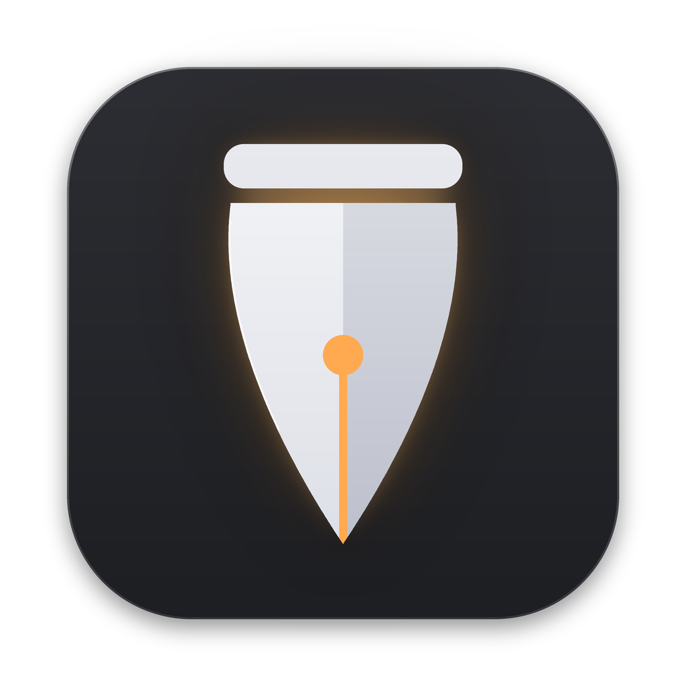
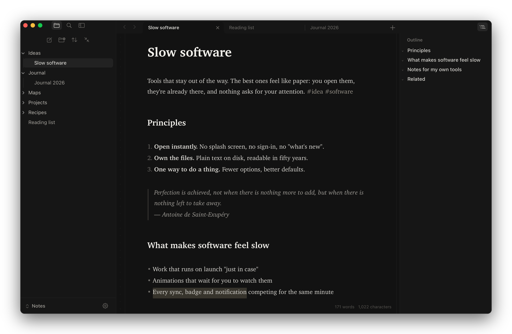
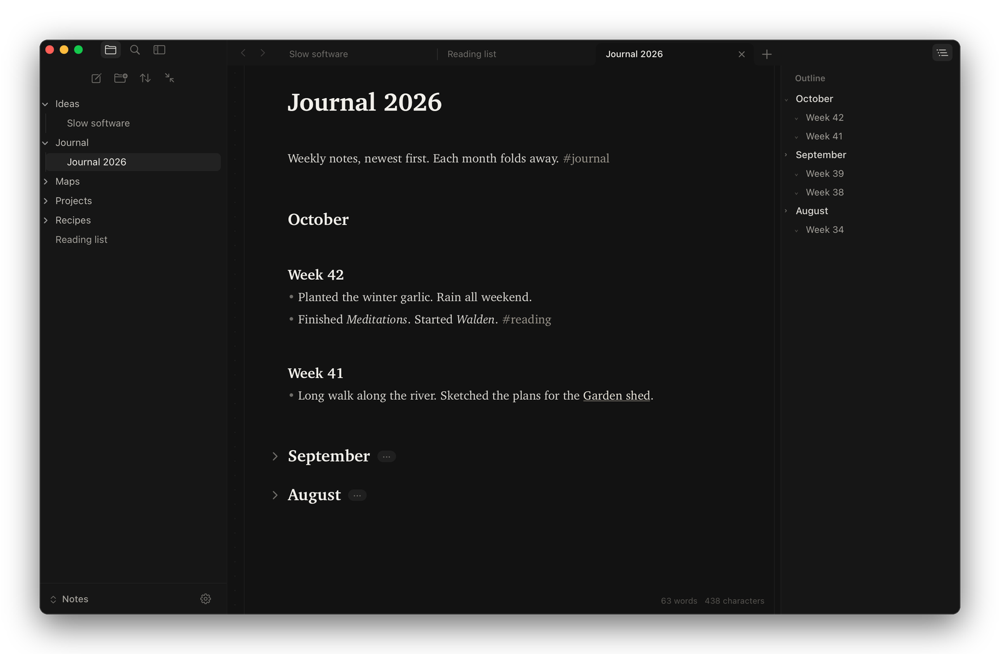
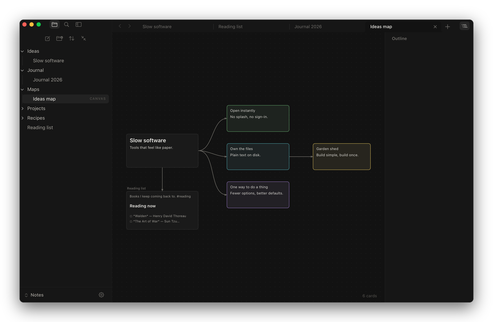
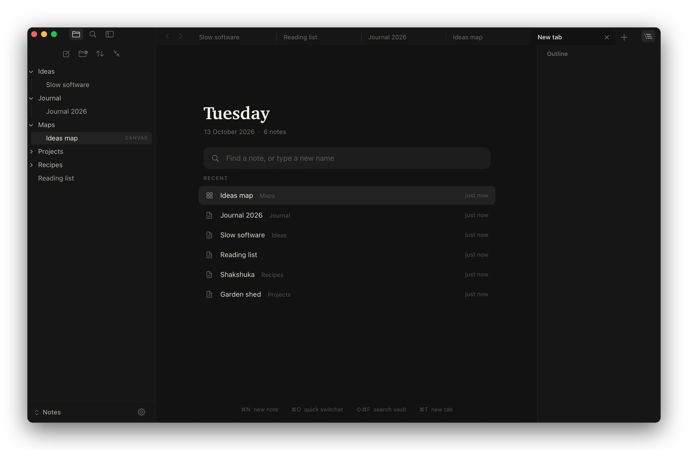
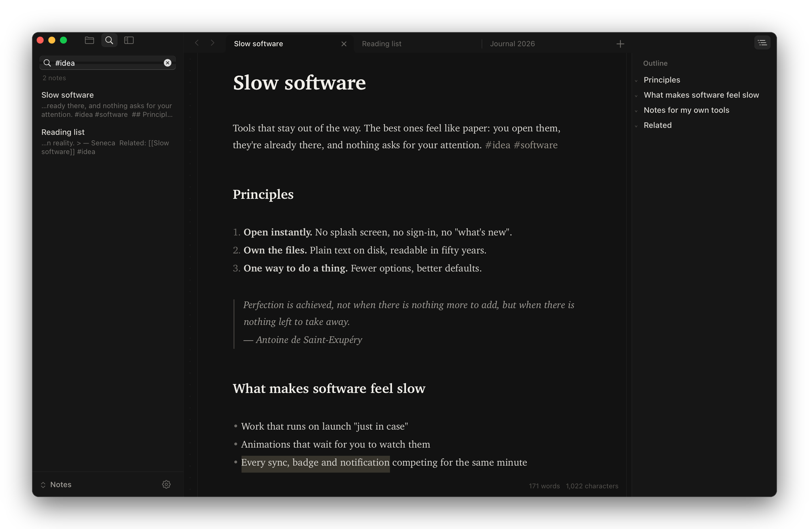
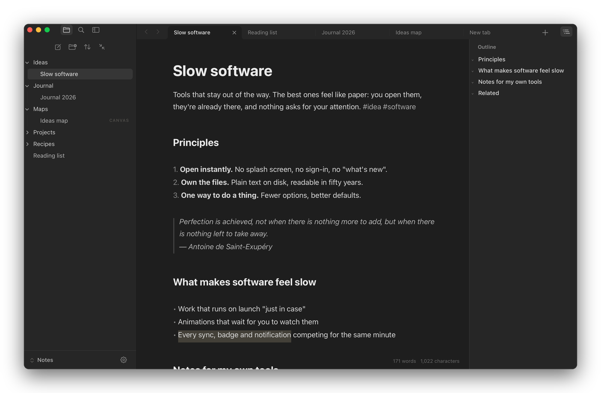

  

<h1 align="center">Quire</h1>

  A fast, quiet Markdown notes app for macOS. 
  Opens an Obsidian vault (or any folder of <code>.md</code> files) in place: nothing is imported, converted or synced.

  
  
  
  

  

Built for one person's daily use and shared as-is.

## What it does

- **Live preview**: headings, bold, italic, highlights, code blocks, quotes, lists, rules, `[[links]]`, `#tags` and clickable checkboxes render as you type. Markdown symbols are hidden and only reappear, faintly, on the line you're editing.
- **Tabs** like a browser: ⌘-click a link to open it in a new tab, each tab keeps its own back/forward history, and a note or canvas is never open in two tabs at once. Tabs are restored on launch.
- **Fold headings** by clicking the chevron beside them. Folds are remembered per note, so a long journal can stay collapsed by year and month.
- **Outline panel** (⌥⌘O): every heading in the note; click to jump, or click its chevron to fold.
- **Files and search** in the sidebar: new note, new folder, sort, collapse all, drag to move, rename, Move to Trash.
- **Search and tags**: full-text search across the vault, or `#tag` search; an empty search lists every tag with its count.
- **Canvases**: opens `.canvas` files (the open JSON Canvas format). Pan, zoom, move and resize cards, double-click to edit or add one.
- **Quick switcher** (⌘O): type to find a note, ⇧↩ to create one, ⌘-click to open it in a new tab.
- **Fast on big notes**: notes of hundreds of thousands of characters open without stalling, with the part you're looking at styled first.
- **Two looks** (Settings): Quire (serif page on a dotted desk) or Flat (sans on flat grey), plus optional line numbers.
- Autosaves as you type. If the file changes on disk while you have unsaved edits, your version is kept as a "(conflict)" copy rather than overwriting.

## Screenshots

<table>
  <tr>
    <td width="50%">
Fold a long journal by month
</td>
    <td width="50%">
Canvases
</td>
  </tr>
  <tr>
    <td width="50%">
New tab: jump to any note
</td>
    <td width="50%">
Search and tags
</td>
  </tr>
  <tr>
    <td colspan="2">
The second look: sans on flat grey
</td>
  </tr>
</table>

Screenshots use a sample vault.

## Build

You need macOS 11 or later and Apple's free Command Line Tools (no Xcode). If they're missing, the build script offers to install them.

1. Download or clone this repository.
2. Double-click **Build Quire.command** (or run `./quire build` in Terminal).
3. Quire opens and asks for your vault folder.

The script builds one app for both Intel and Apple silicon Macs. Run it again any time `Quire.m` changes.

## Keyboard

| | |
|---|---|
| New note / folder / tab | ⌘N / ⇧⌘N / ⌘T |
| Close tab / window | ⌘W / ⇧⌘W |
| Next / previous tab | ⌃⇥ / ⌃⇧⇥ (or ⇧⌘] / ⇧⌘[) |
| Quick switcher | ⌘O |
| Search all notes | ⇧⌘F |
| Insert today's date | ⌘D |
| Bold, italic, strikethrough, highlight | ⌘B, ⌘I, ⇧⌘X, ⇧⌘H |
| Link to note, checkbox | ⌘K, ⌘L |
| Heading 1–3, body text | ⌘1–⌘3, ⌥⌘0 |
| Fold / unfold heading | ⌥⌘[ / ⌥⌘] (add ⇧ for all) |
| Outline panel | ⌥⌘O |
| Back / forward | ⌘[ / ⌘] |
| Hide sidebar | ⌘\ |
| Move to Trash | ⌥⌘⌫ |

## Notes

- Everything lives in `Quire.m` (Objective-C, AppKit and TextKit 1). No dependencies.
- Settings (vault location, text size, page width, look, line numbers, date format) are stored in the app's preferences, not in the repository.
- MIT licence.
