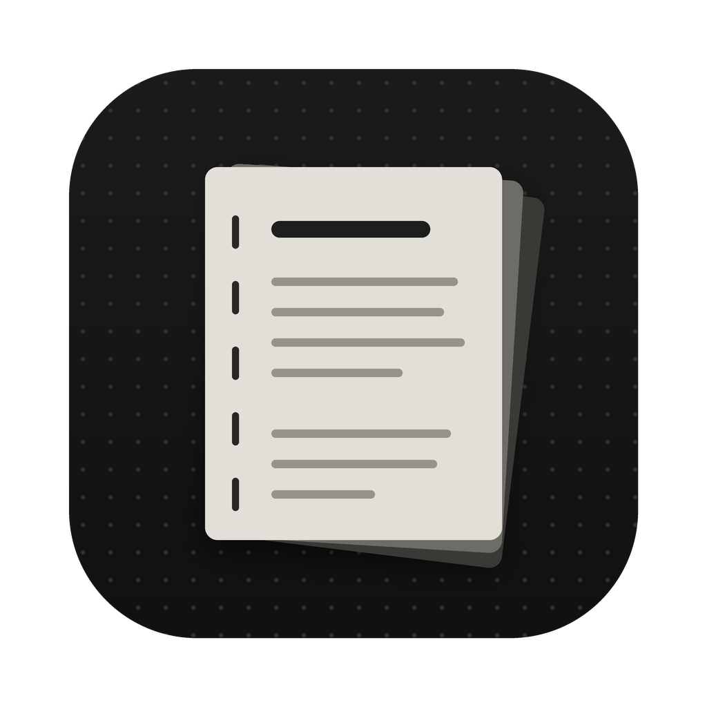

# Quire

A fast, quiet Markdown notes app for macOS. It opens an Obsidian vault (or any folder of `.md` files) in place: nothing is imported, converted or synced.

Built for one person's daily use and shared as-is.

## What it does

- **Files and search** in an Obsidian-style sidebar: new note, new folder, sort, collapse all, drag to move, rename, Move to Trash.
- **Live Markdown** on a dark page: headings, bold, italic, highlights, code, quotes, lists, `[[links]]`, `#tags` and clickable checkboxes. Markdown symbols stay visible but faint.
- **Fold headings** (click the chevron beside a heading, or ⌥⌘[ and ⌥⌘]). Folds are remembered per note.
- **Search and tags**: full-text search across the vault, or `#tag` search; an empty search lists every tag with its count.
- **Canvases**: opens Obsidian `.canvas` files. Pan, zoom, move and resize cards, double-click to edit or add a card.
- **Daily and weekly notes** (⌘D, ⇧⌘D) with folder layouts you set, e.g. `Daily/2026/October/2026-10-12.md`.
- **Quick switcher** (⌘O): type to find a note, ⇧↩ to create one.
- Autosaves as you type. If the file changes on disk while you have unsaved edits, your version is kept as a "(conflict)" copy rather than overwriting.

## Build

You need macOS 11 or later and Apple's free Command Line Tools (no Xcode). If they're missing, the build script offers to install them.

1. Download or clone this repository.
2. Double-click **Build Quire.command** (or run `./quire build` in Terminal).
3. Quire opens and asks for your vault folder.

The script builds one app for both Intel and Apple silicon Macs. Run it again any time `Quire.m` changes.

## Keyboard

| | |
|---|---|
| New note / folder | ⌘N / ⇧⌘N |
| Quick switcher | ⌘O |
| Search all notes | ⇧⌘F |
| Today / this week | ⌘D / ⇧⌘D |
| Bold, italic, highlight | ⌘B, ⌘I, ⇧⌘H |
| Link to note, checkbox | ⌘K, ⌘L |
| Heading 1–3, body text | ⌘1–⌘3, ⌥⌘0 |
| Fold / unfold heading | ⌥⌘[ / ⌥⌘] |
| Back / forward | ⌘[ / ⌘] |
| Hide sidebar | ⌘\ |

## Notes

- Everything lives in `Quire.m` (Objective-C, AppKit and TextKit 1). No dependencies.
- Settings (vault location, text size, page width, daily and weekly note formats) are stored in the app's preferences, not in the repository.
- MIT licence.
